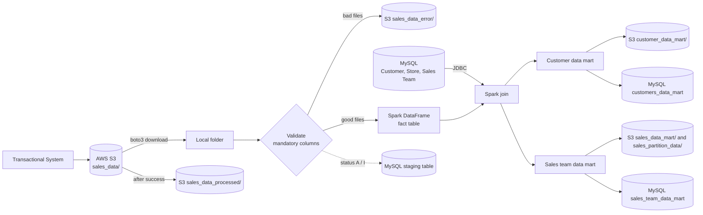

# Retail Sales Data Engineering Pipeline (Spark + AWS S3 + MySQL)

An end-to-end batch data pipeline that reads transactional sales data from **AWS S3**, validates it, enriches it with dimension tables from **MySQL** using **Apache Spark**, and writes reporting-ready **data marts** to Parquet (S3) and to MySQL.

> Status: **All 6 releases complete.** See the [Release History](#release-history).

---

## Table of Contents

1. [What are we doing?](#1-what-are-we-doing)
2. [Why are we doing it?](#2-why-are-we-doing-it)
3. [How are we doing it?](#3-how-are-we-doing-it)
4. [Architecture](#architecture)
5. [Pipeline Flow](#pipeline-flow)
6. [Release History](#release-history)
7. [Data Model](#data-model)
8. [Business Logic](#business-logic)
9. [Project Structure](#project-structure)
10. [Getting Started](#getting-started)
11. [Security Notes](#security-notes)
12. [Future Improvements](#future-improvements)

---

## 1. What are we doing?

- Reading sales files from an **AWS S3 bucket** (generated by a transactional system)
- **Validating** the data (mandatory columns, bad files, extra columns)
- **Enriching** the sales (fact) data with customer, store and sales team dimension tables
- **Transforming** it based on business rules
- **Writing** the results into **data marts** (Parquet on S3 and tables in MySQL)

## 2. Why are we doing it?

- The business wants to **incentivise the top salesperson** of each store based on monthly sales.
- Customer spending is tracked per month so a **coupon / discount** can be offered.
- Reporting tools need clean, ready-to-query **data marts**.

## 3. How are we doing it?

- **Spark (PySpark)** reads the CSV files and the MySQL dimension tables (over JDBC) and joins them.
- **boto3** connects to S3 for listing, downloading, uploading and moving files.
- **AES encryption** protects the AWS access and secret keys stored in the config.
- A **MySQL staging table** tracks every processed file so a failed run can be detected.

---

## Architecture



## Pipeline Flow

1. **Decrypt** the AWS keys and create the S3 client.
2. **Check the previous run**: look in `product_staging_table` for files with status `A` (a run that did not finish).
3. **List and download** CSV files from `sales_data/` to the local folder.
4. **Validate** each file against the mandatory columns. Bad files go to the local error folder and to `sales_data_error/` in S3.
5. **Record** the good files in the staging table with status `A`.
6. **Build the fact DataFrame**: union all good files; any extra columns are combined into `additional_columns`.
7. **Load dimension tables** from MySQL and **join** them with the fact data.
8. **Build the data marts** (customer and sales team) and write them as Parquet, then upload to S3. The sales team mart is also written partitioned by `sales_month` and `store_id`.
9. **Calculate** monthly totals and incentives and write them to MySQL.
10. **Archive** the processed files in S3 (`sales_data_processed/`), **delete** the local files, and set the staging status to `I`.

---

## Release History

| Release | Tag | What was added |
|---|---|---|
| 1 | `v1.0` | Project structure, virtual environment, config template, `.gitignore` |
| 2 | `v2.0` | AES encryption of AWS keys, `S3ClientProvider`, logging, S3 connection test |
| 3 | `v3.0` | MySQL connection, previous-run check, S3 file listing and download, Spark session |
| 4 | `v4.0` | Schema validation, error file handling, staging table, extra-column handling, dimension join |
| 5 | `v5.0` | Customer and sales team data marts, Parquet output, S3 upload, partitioned write |
| 6 | `v6.0` | Monthly calculations and incentives to MySQL, S3 archiving, local cleanup, staging status update |

---

## Data Model

### 1. Fact Table (CSV files on S3)

| Field | Type |
|---|---|
| customer_id | int |
| store_id | int |
| product_name | varchar(200) |
| sales_date | date |
| sales_person_id | int |
| price | float |
| quantity | int |
| total_cost | float |
| additional_columns | varchar(1000) |

> Any column beyond the mandatory ones is concatenated into `additional_columns` instead of being lost.

### 2. Customer Table (Dimension)

| Field | Type |
|---|---|
| customer_id | int |
| first_name | varchar(50) |
| last_name | varchar(50) |
| address | varchar(255) |
| pincode | varchar(10) |
| phone_number | varchar(20) |
| customer_joining_date | date |

### 3. Store Table (Dimension)

| Field | Type |
|---|---|
| id | int |
| address | varchar(255) |
| store_pincode | varchar(10) |
| store_manager_name | varchar(100) |
| store_opening_date | date |
| reviews | text |

### 4. Product Table (Dimension, SCD Type 2)

| Field | Type |
|---|---|
| id | int |
| name | varchar(255) |
| current_price | decimal(10,2) |
| old_price | decimal(10,2) |
| created_date | timestamp |
| updated_date | timestamp |
| expiry_date | date |

### 5. Sales Team Table (Dimension)

| Field | Type |
|---|---|
| id | int |
| first_name | varchar(50) |
| last_name | varchar(50) |
| manager_id | int |
| is_manager | char(1) |
| address | varchar(255) |
| pincode | varchar(10) |
| joining_date | date |

### 6. Staging Table (auditing and process tracking)

Tracks every file processed by the pipeline.

| id | file_name | file_location | created_date | updated_date | status |
|---|---|---|---|---|---|
| 3 | sales_data.csv | local path | 2026-11-22 09:07:45 | NULL | A |

`status`: `A` = Active / in progress, `I` = Inactive / completed.

### 7. Customer Data Mart (MySQL `customers_data_mart`)

| customer_id | full_name | address | phone_number | sales_date_month | total_sales |
|---|---|---|---|---|---|
| 1 | Saanvi Krishna | Delhi | 9173121081 | 2026-04 | 400.00 |

### 8. Sales Team Data Mart (MySQL `sales_team_data_mart`)

| store_id | sales_person_id | full_name | sales_month | total_sales | incentive |
|---|---|---|---|---|---|
| 121 | 3 | Amit Sharma | 2026-03 | 6573.50 | 65.74 |

---

## Business Logic

- **Customer data mart:** total of `total_cost` per customer per month (`sales_date_month`).
- **Sales team data mart:** total of `total_cost` per store, salesperson and month.
- **Incentive:** within each store and month, the salesperson with the highest total sales receives **1% of that total**; everyone else receives `0`. Ties are all ranked 1st, so tied salespeople each receive the incentive.

---

## Project Structure

```
Project_Repo/
├── README.md
├── .gitignore
├── docs/
│   ├── architecture.png
│   └── database_schema.png
├── resources/
│   ├── __init__.py
│   └── dev/
│       ├── __init__.py
│       ├── config_example.py        # template with placeholders (copy to config.py)
│       ├── config.py                # your real settings (git-ignored)
│       └── requirements.txt
└── src/
    ├── main/
    │   ├── download/
    │   │   └── aws_file_download.py     # S3FileDownloader
    │   ├── move/
    │   │   └── move_files.py            # move_s3_to_s3
    │   ├── read/
    │   │   ├── aws_read.py              # S3Reader (list files)
    │   │   └── database_read.py         # DatabaseReader (MySQL to Spark)
    │   ├── transformations/
    │   │   ├── main.py                  # pipeline entry point
    │   │   ├── dimension_tables_join.py # fact + dimension joins
    │   │   ├── customer_mart_sql_transform_write.py
    │   │   └── sales_mart_sql_transform_write.py
    │   ├── upload/
    │   │   └── upload_to_s3.py          # UploadToS3
    │   ├── utility/
    │   │   ├── encrypt_decrypt.py       # AES encrypt / decrypt
    │   │   ├── logging_config.py
    │   │   ├── my_sql_session.py
    │   │   ├── s3_client_object.py      # S3ClientProvider
    │   │   └── spark_session.py
    │   └── write/
    │       ├── format_writer.py         # FormatWriter (Parquet etc.)
    │       └── database_write.py        # DatabaseWriter (Spark to MySQL)
    └── test/
        └── sales_data_upload_s3.py      # helper to upload sample data
```

> File names under `transformations/` and the location of `delete_local_file` may differ slightly in your copy. Adjust this tree to match your folders.

---

## Getting Started

### Prerequisites

- Python 3.10+
- Java compatible with your PySpark version (for example Java 17)
- An AWS account with an S3 bucket
- MySQL with the dimension and staging tables created
- **Windows only:** `winutils.exe` and `hadoop.dll` in a folder such as `C:\hadoop\bin`, with `HADOOP_HOME=C:\hadoop` set. Spark needs this to write files locally.

### S3 bucket layout

```
<bucket>/
├── sales_data/              # incoming CSV files
├── sales_data_processed/    # archived after a successful run
├── sales_data_error/        # files that failed validation
├── customer_data_mart/      # customer mart (Parquet)
├── sales_data_mart/         # sales team mart (Parquet)
└── sales_partition_data/    # sales team mart partitioned by month and store
```

### Setup

```bash
git clone https://github.com/suryanshuna100/Retail-Sales-Data-Engineering-Pipeline-Spark-AWS-S3-.git
cd Retail-Sales-Data-Engineering-Pipeline-Spark-AWS-S3-

python -m venv .venv
.venv\Scripts\activate            # Linux/macOS: source .venv/bin/activate

pip install -r resources/dev/requirements.txt
```

### Configuration

1. Copy `resources/dev/config_example.py` to `resources/dev/config.py`.
2. Fill in your own values:
   - `key`, `iv`, `salt` for encryption
   - your **encrypted** AWS access and secret keys
   - bucket and S3 directory names
   - MySQL URL, user and password
   - local folder paths
3. Never commit `config.py`. It is listed in `.gitignore`.

### Run

From the `Project_Repo` folder:

```bash
python -m src.main.transformations.main
```

### Before a re-run during testing

If a run failed halfway, the staging table keeps rows with status `A` and the local folder keeps the CSV. Clear those rows and delete the local files before running again.

---

## Security Notes

- AWS keys are stored **encrypted** (AES with PBKDF2 key derivation) and decrypted only in memory.
- `config.py` is git-ignored. Only `config_example.py` with placeholders is committed.
- Rotate any key that was ever committed or shared.

---

## Future Improvements

- Orchestrate with Airflow for daily and monthly schedules
- Parameterised SQL everywhere and retry handling for S3 and MySQL calls
- Unit tests for validation, joins and incentive logic
- Pin dependency versions
- Move to Delta Lake or Redshift for the serving layer
- CI/CD with GitHub Actions
- Data quality checks (for example Great Expectations)

---


## Author

**Suryanshu** · [GitHub](https://github.com/suryanshuna100)
