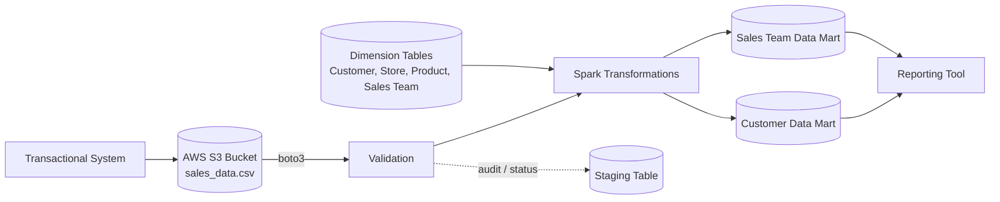

# Retail Sales Data Engineering Pipeline (Spark + AWS S3)

An end-to-end batch data pipeline that reads transactional sales data from **AWS S3**, validates it, transforms it with **Apache Spark** based on business rules, and writes reporting-ready **data marts** to a relational database.

---

## Table of Contents

1. [What are we doing?](#1-what-are-we-doing)
2. [Why are we doing it?](#2-why-are-we-doing-it)
3. [How are we doing it?](#3-how-are-we-doing-it)
4. [Architecture](#architecture)
5. [Data Model](#data-model)
6. [Business Logic](#business-logic)
7. [Project Structure](#project-structure)
8. [Getting Started](#getting-started)
9. [Future Improvements](#future-improvements)

---

## 1. What are we doing?

- Reading data from an **AWS S3 bucket**
- The data is generated by a **transactional system**
- **Validating** the data (schema, mandatory columns, bad files)
- **Transforming** the data based on the business use case
- **Writing** the results into **data marts**

## 2. Why are we doing it?

- The business unit wants to **incentivise the billing person** based on total sales.
- Customer spending is tracked, and a **coupon / discount** is provided based on it.
- A **daily report** needs to be generated.
- A **monthly report** also needs to be generated at the end of every month.

## 3. How are we doing it?

- **Spark** is used for transformation.
- Data volume is about **15 GB per day**.
- The **S3 boto3 SDK** is used to connect with S3.
- Data is pushed to the data mart so a **reporting tool** can process it further.

---

## Architecture



## Tech Stack

| Layer | Tool |
|---|---|
| Storage (raw data) | AWS S3 |
| S3 connectivity | boto3 SDK |
| Processing | Apache Spark (PySpark) |
| Serving / Data marts | MySQL (relational DB) |
| Reporting | BI / reporting tool |
| Language | Python |

---

## Data Model

### 1. Fact Table (present on S3)

| Field | Type |
|---|---|
| customer_id | int |
| store_id | int |
| product_name | varchar(200) |
| sales_date | date |
| sales_person_id | int |
| price | float |
| quantity | int |
| total_cost | float |
| additional_column | varchar(1000) |

> `additional_column` is used to handle unexpected or extra columns during validation.

### 2. Customer Table (Dimension)

| Field | Type |
|---|---|
| customer_id | int |
| first_name | varchar(50) |
| last_name | varchar(50) |
| address | varchar(255) |
| pincode | varchar(10) |
| phone_number | varchar(20) |
| customer_joining_date | date |

### 3. Store Table (Dimension)

| Field | Type |
|---|---|
| id | int |
| address | varchar(255) |
| store_pincode | varchar(10) |
| store_manager_name | varchar(100) |
| store_opening_date | date |
| reviews | text |

### 4. Product Table (Dimension, SCD Type 2)

| Field | Type |
|---|---|
| id | int |
| name | varchar(255) |
| current_price | decimal(10,2) |
| old_price | decimal(10,2) |
| created_date | timestamp |
| updated_date | timestamp |
| expiry_date | date |

### 5. Sales Team Table (Dimension)

| Field | Type |
|---|---|
| id | int |
| first_name | varchar(50) |
| last_name | varchar(50) |
| manager_id | int |
| is_manager | char(1) |
| address | varchar(255) |
| pincode | varchar(10) |
| joining_date | date |

### 6. Staging Table (for auditing & process tracking)

Tracks every file processed by the pipeline.

| id | file_name | file_location | created_date | updated_date | status |
|---|---|---|---|---|---|
| 3 | sales_data.csv | sales_data.csv | 2023-08-21 09:07:45 | NULL | A |

`status`: `A` = Active / in progress, `I` = Inactive / completed.

### 7. Customer Data Mart

| customer_id | full_name | address | phone_number | sales_date_month | total_sales |
|---|---|---|---|---|---|
| 1 | Saanvi Krishna | Delhi | 9173121081 | 2023-04 | 400.00 |

Monthly total spend per customer, used to decide coupons / discounts.

### 8. Sales Team Data Mart

| store_id | sales_person_id | full_name | sales_month | total_sales | incentive |
|---|---|---|---|---|---|
| 121 | 3 | Amit Sharma | 2023-03 | 6573.50 | 65.74 |

Monthly total sales per salesperson per store, along with the incentive earned.

---

## Business Logic

- **Customer Data Mart:** aggregate `total_cost` by `customer_id` and month (`sales_date`) to get `total_sales`.
- **Sales Team Data Mart:** aggregate `total_cost` by `store_id`, `sales_person_id` and month.
- **Incentive:** from the sample output, the top salesperson of each store for the month receives **1% of their total sales** as incentive; others get `0.00`. *(Update this section if your rule differs.)*

---

## Project Structure

```
.
├── README.md
├── requirements.txt
├── config/
│   └── config.py              # AWS, DB, and S3 settings
├── resources/
│   └── sql/                   # DDL scripts for tables
├── src/
│   ├── main/
│   │   ├── download/          # S3 download using boto3
│   │   ├── read/              # Spark readers
│   │   ├── transformations/   # Joins, aggregations, incentive logic
│   │   ├── validation/        # Schema & file checks
│   │   ├── write/             # Writers to data marts
│   │   └── utility/           # Logging, DB connector, helpers
│   └── test/
└── docs/
    └── images/                # Architecture / schema screenshots
```

---

## Getting Started

### Prerequisites

- Python 3.8+
- Apache Spark 3.x
- Java 8 or 11
- An AWS account with S3 access
- MySQL (or your chosen relational DB)

### Setup

```bash
# clone the repo
git clone https://github.com/<your-username>/<your-repo>.git
cd <your-repo>

# create a virtual environment
python -m venv venv
source venv/bin/activate        # Windows: venv\Scripts\activate

# install dependencies
pip install -r requirements.txt
```

### Configuration

Create `config/config.py` (do **not** commit real credentials):

```python
aws_access_key = "<your-access-key>"
aws_secret_key = "<your-secret-key>"
bucket_name    = "<your-bucket>"
s3_source_dir  = "sales_data/"

db_host = "localhost"
db_name = "<your-db>"
db_user = "<user>"
db_pass = "<password>"
```

> Tip: add `config/config.py` and any `.env` files to `.gitignore`. Prefer environment variables or AWS Secrets Manager for credentials.

### Run

```bash
python src/main/transformations/main.py
```

---

## Future Improvements

- Orchestrate with Airflow for daily and monthly schedules
- Add unit tests for validation and transformation logic
- Move to Delta Lake / Redshift for the serving layer
- CI/CD with GitHub Actions
- Data quality checks (e.g., Great Expectations)

---

## Author

**<Your Name>** · [LinkedIn](https://linkedin.com/in/<your-profile>) · [GitHub](https://github.com/<your-username>)
